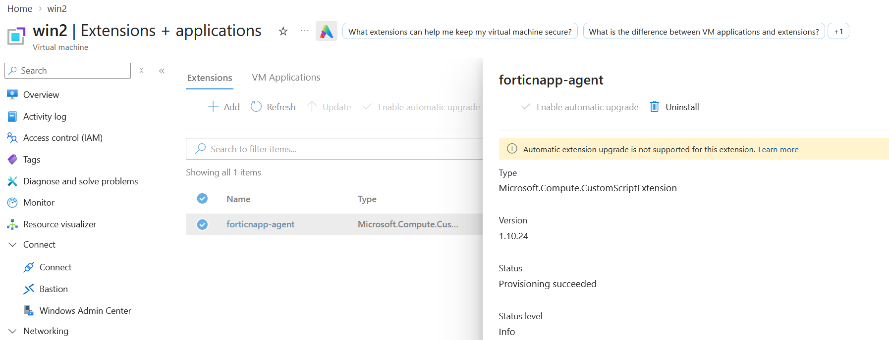

# FortiCNAPP Windows Agent – Azure VM Deployment

Terraform code to install or uninstall the **FortiCNAPP (Lacework) Windows agent** on multiple existing Azure Windows VMs, controlled by a single variable.

## What it does

- Deploys the agent to a number of existing Windows VMs across one or more resource groups.
- Uses the Azure **Custom Script Extension** to run Fortinet's documented `Install-LWDataCollector.ps1` script.



- **`install_agent = true`** → installs the agent, and optionally excludes it from Microsoft Defender scanning.
- **`install_agent = false`** → uninstalls the agent using Fortinet's documented uninstall script.


## Prerequisites

| Requirement | Details |
|---|---|
| Terraform | `>= 1.5.0` |
| AzureRM provider | `~> 4.0` |
| Azure access | Rights to manage VM extensions on the target VMs (e.g. *Virtual Machine Contributor*) |
| Target VMs | Windows, **running**, outbound HTTPS to `updates.lacework.net` and your FortiCNAPP server URL |
| FortiCNAPP | An agent access token, plus the MSI and script URLs for the release you want (Windows agent releases page) |


## Files

| File | Purpose |
|---|---|
| `main.tf` | Provider, VM lookup, Custom Script Extension (install/uninstall logic) |
| `variables.tf` | Input variables and validation |
| `terraform.tfvars` | Your environment values |

## Deployment

**1. Configure `terraform.tfvars`**

```hcl
subscription_id = "<subscription-id>"
install_agent   = true

vms = [
  { name = "win-vm-01", resource_group_name = "rg-app-prod" },
  { name = "win-vm-02", resource_group_name = "rg-app-dev" },
]

install_script_url = "https://updates.lacework.net/windows/<Release-Version>/Install-LWDataCollector.ps1"
agent_msi_url      = "https://updates.lacework.net/windows/<Release-Version>/LWDataCollector.msi"
agent_server_url   = "https://api.fra.lacework.net"
```

Agent server URLs by region:

| Region | URL |
|---|---|
| US | `https://api.lacework.net` |
| US-02 | `https://aprodus2.agent.lacework.net` |
| EU | `https://api.fra.lacework.net` |
| ANZ | `https://auprodn1.agent.lacework.net` |

**2. Provide the access token**

Pass it as an environment variable. Don't put it in `terraform.tfvars`.

```bash
export TF_VAR_agent_access_token="<token>"        # Linux / macOS
```
```powershell
$env:TF_VAR_agent_access_token = "<token>"        # PowerShell
```
```cmd
set TF_VAR_agent_access_token=<token>             # Windows cmd (no quotes)
```

**3. Deploy**

```bash
az login
terraform init
terraform plan
terraform apply
```

**Uninstall**

```bash
terraform apply -var install_agent=false
```

## Use cases

- **Proof of value / onboarding:** roll the agent out to a set of customer VMs in minutes, then remove it cleanly when the evaluation ends.
- **Fleet rollout:** add new VMs to the `vms` list and re-apply.
- **Controlled removal:** uninstall from all listed VMs with one variable change, without logging in to each host.
- **Version change:** apply with `false`, update the release URLs, then apply with `true`.

## Notes

- `terraform destroy`, or removing a VM from `vms`, deletes only the extension. **The agent stays installed.** Run with `install_agent = false` first.
- The access token is stored in Terraform state. Use a secured remote backend.
- Troubleshooting logs on the VM: `C:\WindowsAzure\Logs\Plugins\Microsoft.Compute.CustomScriptExtension\`
- Troubleshooting windows agent errors, review the LWDataCollector log files in the C:\ProgramData\Lacework\Logs directory.

Enter the following command to check status for the lwdatacollector service: 
- In Powersehll:
```bash
sc.exe query lwdatacollector
```
or
- In Command Prompt
```bash
sc query lwdatacollector
```

Stop the window agent with the following command:  

```bash
sc.exe stop lwdatacollector
```

Restart the window agent with the following command:  

```bash
sc.exe start lwdatacollector

## References

- [Installing the Windows agent using a PowerShell script](https://docs.fortinet.com/document/forticnapp/latest/administration-guide/169764/installing-the-windows-agent-using-a-powershell-script)
- [Uninstalling the Windows agent](https://docs.fortinet.com/document/forticnapp/26.2.0/administration-guide/558434/uninstalling-the-windows-agent)
- [Custom Script Extension for Windows](https://learn.microsoft.com/azure/virtual-machines/extensions/custom-script-windows)
